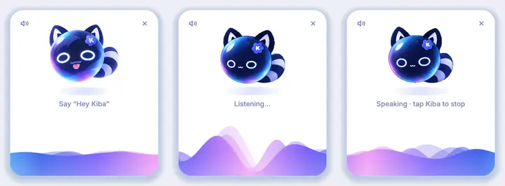

  

# kAI

Local, offline voice assistant (the command is `kibavoice`). Say **"Hey Kiba"**, then ask. A small llama.cpp model
answers and Piper reads it aloud.

The window is voice-only: a rounded white card (always light, no dark mode) with the Kiba
orb mascot on top (tongue-out idle pose, animated while it listens / thinks / speaks) and
a gradient wave at the bottom in the mascot's colors that follows your microphone.
No text box, no chat history.

| Part | What | Fetched automatically |
|------|------|-----------------------|
| LLM  | llama.cpp (linked), Qwen2.5-0.5B-Instruct Q4_K_M, ~400 MB | first run |
| STT  | whisper.cpp `whisper-cli` + `ggml-tiny.en.bin`, ~75 MB | first run |
| TTS  | Piper v1.2.0 binary + `en_US-john-medium` voice | first run |
| UI   | Qt6 Widgets (`kibavoice-ui`) | built with the project |

Models land in `~/.local/share/kibavoice/`. Override with `KIBAVOICE_LLM_URL`,
`KIBAVOICE_STT_URL`, `KIBAVOICE_VOICE` (e.g. `en_US-bryce-medium`), `KIBAVOICE_SYSTEM`.

## Install (one command)

    ./install.sh --deps      # --deps installs packages via apt/pacman/dnf (needs sudo); omit if you have them

That builds everything, installs to `~/.local`, downloads the models (~550 MB), adds **Kiba** to your
app menu, and installs the always-on daemon. Other flags: `--no-service` (launcher only),
`--no-models` (download on first run instead), `--prefix DIR`, `--uninstall`.

Manual build, if you prefer. Needs cmake >= 3.18, a C++17 compiler, git, curl, and Qt6
(Widgets + Network): `qt6-base-dev` on Debian/Ubuntu, `qt6-base` on Arch. Runtime: `alsa-utils`
(arecord), one of paplay / pw-play / aplay.

    cmake -B build -DCMAKE_INSTALL_PREFIX=$HOME/.local
    cmake --build build -j
    cmake --install build
    kibavoice fetch                       # models (optional; also happens on first run)
    kibavoice doctor                      # shows what is missing
    kibavoice install-desktop             # menu entry + icon
    kibavoice install-service             # always-on daemon

No Qt? Configure with `-DKIBAVOICE_BUILD_UI=OFF` for the CLI only.

## Always-on daemon

`kibavoice install-service` writes `~/.config/systemd/user/kibavoice.service` and enables it. It
runs `kibavoice-ui --background` in your desktop session from login on: the microphone stays open,
the window is hidden, and it pops up when you say "Hey Kiba".

    systemctl --user status kibavoice
    journalctl --user -u kibavoice -f
    kibavoice-ui --quit                   # stop it (stays stopped until next login)
    kibavoice uninstall-service

- It is a **user** service on purpose: the mic, speakers and window belong to your login session,
  so a system-wide service could not use them.
- Restarts automatically after a crash (`Restart=on-failure`). A clean quit (tray menu, `--quit`)
  is respected and is not restarted.
- Self-heals: if the mic is busy or missing it retries every 15 s; if the first-run download fails
  (no network at login) it retries every minute.
- In daemon mode the window's **x** and **Esc** only hide it. A tray icon (Show / Talk / Quit)
  appears when your desktop has a system tray.
- Launching **Kiba** from the app menu while the daemon runs just brings its window up and keeps
  it up until you close it.
- Window managers that do not start `graphical-session.target` (some bare i3/sway setups) will not
  auto-start the unit. Use `kibavoice install-desktop --autostart` there, or add
  `systemctl --user start kibavoice` to your WM startup. On sway/Hyprland also run
  `dbus-update-activation-environment --systemd WAYLAND_DISPLAY DISPLAY` at startup so the service
  can see your display.

## Use

    kibavoice-ui               # open the window and wait for "Hey Kiba"
    kibavoice-ui --background  # start hidden; the window pops up when you say it,
                               #   and tucks away a few seconds after Kiba finishes
    kibavoice-ui --listen      # open and listen right away (skip the wake phrase)
    kibavoice-ui --quit        # stop a running instance

- **"Hey Kiba."** then ask when the status says *Listening…* It stops by itself after about
  a second of silence. You can also say it in one go: *"Hey Kiba, what time is it?"*
- **Tap the wave** to talk without the wake phrase (tap again to send early).
  **Tap Kiba** while it is speaking to stop it.
- **Speaker icon** (top left) mutes spoken answers, **x** or **Esc** quits. Drag anywhere to move.
- Launching it again while it is running just brings the existing window forward
  (`kibavoice-ui --listen` makes a good hotkey).

## How the wake word works

No cloud and no extra wake-word engine. The microphone stays open, cuts the stream into short
speech segments, and runs each one through whisper.cpp (tiny.en, greedy decoding, primed with
"Hey Kiba") on your CPU. The text is matched loosely (Keba, Kibba, Keeba, Cuba all count, but
only after a greeting or as the first word). Segments that don't match are deleted straight
away; nothing is stored or sent anywhere.

Trade-offs worth knowing:
- Whisper runs on every stretch of speech it hears, so expect some background CPU use
  in a talkative room.
- The recorder keeps the microphone device open, so other apps may not be able to use it
  exclusively. Quit the window (Esc) to release it.
- While Kiba thinks and speaks the mic is paused, so it can't trigger itself.
- Use headphones if your speakers are loud: a long answer can still leak into the next check.

## CLI

    kibavoice ask <text> [--no-speak] [--no-notify]
    kibavoice listen [--no-speak] [--no-notify]
    kibavoice transcribe <file.wav> [--wake]
    kibavoice say <text>
    kibavoice history | show <id> | replay <id>

## Notes

- The UI is a separate process that drives the CLI (`fetch`, `transcribe`, `ask`, `say`),
  so the CLI keeps working on its own. `kibavoice history` still records every question.
- Child processes are started with an argv vector, never a shell, so text from the model or
  the microphone cannot inject commands. `KIBAVOICE_REC_CMD` overrides the recorder command.
- On Wayland, "always on top" is up to the compositor; use a window rule to pin it.
- whisper.cpp is a separate process on purpose: it and llama.cpp each bundle their own ggml.
- Piper here is the archived rhasspy/piper v1.2.0 build (MIT). The maintained
  OHF-Voice/piper1-gpl is GPL-3.0 and is the upgrade path.
